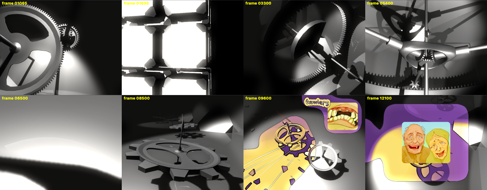

# Syntonic Dentiforms（Odin 移植版）

[Syntonic Dentiforms](https://github.com/aras-p/SyntonicDentiforms) 是立陶宛小组 Nesnausk! 在 Breakpoint 2004 发的 demo，拿过 scene.org 的 Breakthrough Performance 奖。它在 2004 年是 Direct3D 9 上的 C++ 程序；2026 年 Aras Pranckevičius 用 sokol 重制了它（[博文](https://aras-p.info/blog/2026/04/13/Syntonic-Dentiforms-redux/)）。

这个仓库把重制版移植到了 **Odin + sokol-odin**。移植、验证和这些文档由 AI 助手（ZCode）完成。



> **只能自用，不要公开。** 原项目没有许可证文件，默认保留所有权利。这里包含它的音乐、美术、shader，以及由它的源码移植来的代码。详见[许可](#许可)。

## 状态

可以完整播放，画面与 C++ 重制版一致到 2/255 以内。

| 检查 | 结果 |
|---|---|
| 离屏渲染 22 帧，发布版和调试版 | 最差的一帧有 99.97% 的像素与 C++ 版相差不超过 2（满量程 255），单帧平均差最大 0.008；其中 3 帧逐位相同 |
| 密集采样 132 帧 | 平均 99.994% 的像素相差不超过 2 |
| 窗口模式 5 帧 | 100%、99.99%、99.99%、99.99%、100% 的像素相差不超过 2 |
| 音乐模式 | 12 帧全部落在与 C++ 版对应的帧上 |
| 同一个程序运行两次 | 22 帧逐字节相同 |

参照物是从源码构建的 C++ 重制版。数字是怎么得到的、还有哪些没验证到，见[移植与验证报告](docs/port-report.md)。

## 构建

需要 macOS（Apple Silicon）、Odin `dev-2026-11`，以及编译 C 库用的 clang（Xcode 命令行工具）。移植用的是这个 Odin 版本的语法，其它版本没有试过。

```sh
./build.sh              # 发布版：syntonic-odin
./build.sh debug        # 调试版，带边界检查：syntonic-odin-d
./build.sh debug-keys   # 窗口，用键盘控制时间：syntonic-odin-debug
```

第一次构建会先编译 sokol 绑定的 C 库（`sokol/build_clibs_macos.sh`），大约多花 15 秒。它们是构建产物，不在仓库里。这一步编译器的警告会写进 `build-clibs.log`。

## 运行

```sh
./syntonic-odin                                  # 全屏，音乐作为时钟，正常播放
./syntonic-odin-debug                            # 窗口，时间由键盘控制
./syntonic-odin --capture=105,1065               # 在窗口里按 60 帧每秒渲染，把指定帧存成 captureNNNNN.tga
./syntonic-odin --offscreen --capture=105,1065   # 同上，不开窗口
```

调试窗口里的按键：`←` `→` 前后一帧，`PageUp` `PageDown` 五帧，`1`–`5` 跳到某个场景，`空格` 前进一秒，`F9` 截图存成 `shotNN.tga`，`/` 显示统计，`ESC` 退出。

## 目录

| 位置 | 内容 |
|---|---|
| `*.odin` | 移植的代码，19 个文件 4580 行 |
| `fx/*.glsl` | 原版的 shader 源文件，没有改动 |
| `fx/<名字>/shader.odin` | 由 shader 生成的 Odin 包 |
| `data/` | 原版的数据文件：模型、动画、贴图、音乐 |
| `sokol/` | [floooh/sokol-odin](https://github.com/floooh/sokol-odin) 绑定，连同 sokol 的 C 头文件 |
| `build.sh` | 构建脚本 |
| `tools/build_shaders.sh` | 改了 shader 之后，重新生成 `fx/<名字>/shader.odin` |
| `tools/compare_frames.py` | 逐像素比较两个目录里的帧 |

## 文档

- [移植与验证报告](docs/port-report.md)：移植了什么，怎样和 C++ 版逐像素对照，结果如何，和原版有哪些不同。
- [技术特点分析](docs/technical-analysis.md)：这个 demo 的画面是怎么做出来的，以及它的品味从哪里来。
- [如何用到别的项目](docs/generalization.md)：这些做法分别能搬到哪里，要注意什么。
- [Odin 与 C++：在这个项目里的对比](docs/odin-vs-cpp.md)：Odin 省掉了什么，又付出了什么。

## 重新生成 shader

只有改了 `fx/*.glsl` 才需要。生成的结果已经在仓库里。

`tools/build_shaders.sh` 用 `tools/sokol-shdc`。这是一个第三方的预编译程序，不在仓库里：从 [floooh/sokol-tools-bin](https://github.com/floooh/sokol-tools-bin) 取 `bin/osx_arm64/sokol-shdc` 放进 `tools/`。这次用的那份的 SHA-256 是 `e001e35a32e3e66ee329ac8a595d4634f95cdbed1209210f9c683712fe4e5a4f`。

## 许可

- **原项目没有许可证。** 默认保留所有权利。`data/` 和 `fx/*.glsl` 是它的文件，原样复制；`*.odin` 由它的源码移植而来，是它的派生作品。所以这个仓库只能用于个人学习，不能公开或再分发。想公开的话，先取得作者的许可。
- `sokol/` 来自 [floooh/sokol-odin](https://github.com/floooh/sokol-odin)，zlib 许可，原文在 [`sokol/LICENSE`](sokol/LICENSE)。版本对应上游提交 `4669f2b`（2026-11-21）。其中的 sokol 头文件（`sokol/c/`）也是 zlib 许可。
- `stb_image` 和 `stb_vorbis` 来自 Odin 自带的 vendor 目录。

## 没有验证到的

- 全屏音乐播放没有从头到尾看过。验证时屏幕处于锁定状态，窗口收不到帧，所以验证是用离屏模式做的。
- 没有听过实际的声音输出。音乐时钟只做了静音测试。
- 只在 Apple Silicon 的 macOS 上用 Metal 后端运行过。其它操作系统和图形后端没有运行过；三个后端（Metal、OpenGL、D3D11）的 shader 都已生成。
- 截图和离屏模式只在 Apple Silicon 的 macOS 上可用。
